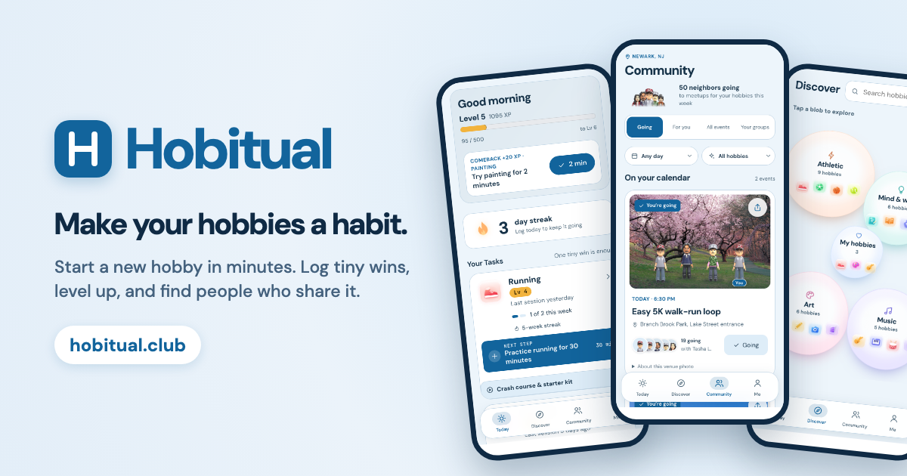
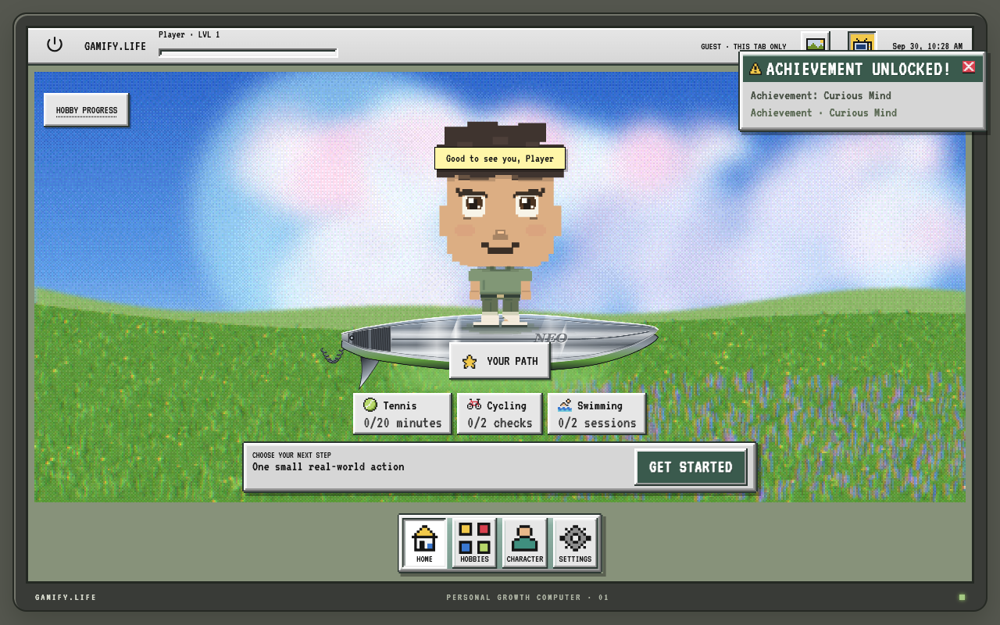
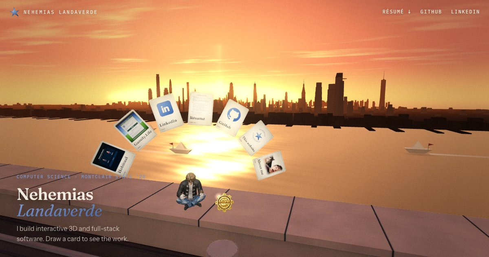
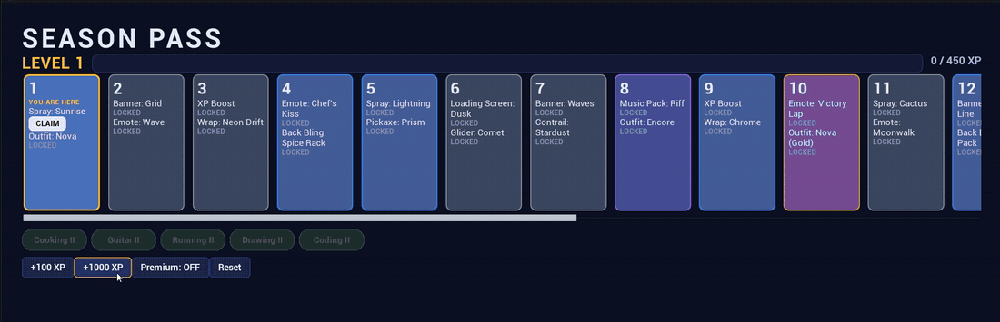

## Hi, I'm Nehemias Landaverde

Computer Science at Montclair State University ('28). I build full-stack web apps and interactive 3D, and I handle deployment and security myself.
**Open to software engineering internships and early-career roles.**

[Portfolio](https://nehemiaslandaverde.com) · [LinkedIn](https://www.linkedin.com/in/nehemiaslandaverde/) · [Résumé](https://nehemiaslandaverde.com/Nehemias-Landaverde-Resume.pdf)

---

### Featured work

<table>
<tr>
<td width="50%" valign="top">

**[Hobitual](https://github.com/Alvaro-bit-stack/Hobitual)** · 🥉 3rd of 197 at GirlHacks 2026

Mobile-first app that turns hobbies into habits: starter plans, one-tap tiny wins, XP and levels. Built in 24 hours with a team of three. I led the 3D character showcase and the Blender Python rigging pipeline behind it. Live on Azure with email sign-in and Azure SQL.

`three.js` `Blender` `Azure` `Gemini` · **[Live](https://hobitual.club)**

</td>
<td width="50%" valign="top">

**[Gamify.Life](https://github.com/Neo-Land/Gamify-Life)**

A retro desktop RPG for real-life hobbies: 121 skills across 10 hobbies as prerequisite graphs, an XP ledger, quests and a pixel character. Server-checked progression (Zod, Postgres advisory locks, row-level security) and 125+ Vitest/Playwright tests.

`Next.js` `TypeScript` `Supabase` `PostgreSQL` `Pixi.js` · **[Live](https://gamify-life-amber.vercel.app)**

</td>
</tr>
<tr>
<td width="50%" valign="top">

**[This portfolio](https://github.com/Neo-Land/personal-website)**

An interactive three.js portfolio: a golden-hour rooftop over Manhattan and a walk-in loft. Scenes modelled and light-baked in Blender by script, skyline and river drawn by shaders, a rigged 3D character. Static on Cloudflare with a strict security policy.

`three.js` `WebGL` `Blender` `Cloudflare` · **[Live](https://nehemiaslandaverde.com)**

</td>
<td width="50%" valign="top">

**[Season Pass UI](https://github.com/Neo-Land/season-pass-ui)**

A game season-pass screen in Unreal Engine 5: 20 reward tiers, free and premium tracks, claimable rewards and saved progress. All rules in C++ with widgets bound through MVVM, covered by 31 automation tests.

`Unreal Engine 5` `C++` `UMG` `MVVM` · **[Demo video](https://youtu.be/X8nqCj49jE0)**

</td>
</tr>
</table>

### Tools I use

**Languages:** Python · Java · C · C++ · TypeScript · JavaScript · SQL
**Web:** React · Next.js · Node · Supabase · PostgreSQL · Tailwind
**3D and games:** three.js · Blender (Python) · Unreal Engine 5
**Cloud:** Azure · Cloudflare · Vercel · Git
